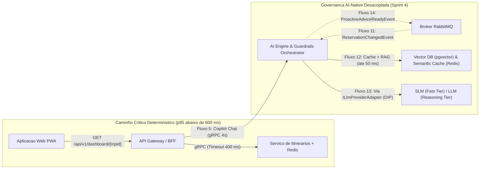

# ADR-006: Adoção de Componentes Probabilísticos (AI Engine / RAG), Guardrails e Estratégia Autonômica com Governança de Custos (Token Economics)

| Metadado | Descrição Oficial |
| :--- | :--- |
| **Código do Registro** | `ADR-006` |
| **Status** | Aceita (Sprint 4 — Encerramento do Projeto) |
| **Projeto** | **The Road Warrior** (Dashboard Global de Viagens em Tempo Real + AI Travel Copilot / Assistente Autonômico de Reacomodação) |
| **Disciplina / Instituição** | Arquitetura de Software — Bacharelado em Engenharia de Software (UniSENAI) |
| **Equipe** | Equipe 5 — **Vibecoders** |
| **Autor (Branch `lucas`)** | **Lucas Sabino da Silva** (Executor na Sprint 4; Líder na Sprint 3) |
| **Participantes da Equipe** | Gabriel Antunes da Silva, Wayron Jhonny de Souza, Eric da Silva Ferraz e Francisco Maganhatto |
| **Decisões Correlatas** | `ADR-001` (Adapters/ACL), `ADR-002` (Mensageria RabbitMQ), `ADR-003` (Topologia Híbrida e Resiliência), `ADR-004` (DDD e `D = 0.0`), `ADR-005` (API Gateway/BFF e Padrões EIP) |

---

## 1. Contexto

Ao longo das Sprints 1, 2 e 3, a plataforma **The Road Warrior** foi consolidada como uma arquitetura distribuída determinística de missão crítica, estruturada em quatro Bounded Contexts e regida por metas inegociáveis elicitadas no *Quality Attribute Workshop* (QAW):

- **Performance:** tempo de resposta `p95 < 600 ms` no carregamento consolidado do painel (`GET /api/v1/dashboard/{tripId}`).
- **Usabilidade:** limite estrito de `<= 1` requisição HTTP por tela no aplicativo cliente PWA (Next.js, React, TypeScript) por meio do padrão Facade/Aggregator no `DashboardAggregatorService`.
- **Escalabilidade:** sustentação de `500.000` usuários conectados simultaneamente com *Load Leveling* no broker RabbitMQ (`AMQP 0-9-1` e Dead Letter Queue `itinerary.sync.dlq`).
- **Disponibilidade e Resiliência:** disponibilidade global `>= 99,9%` apoiada em PWA *Offline-First* (`OfflineSyncServiceWorker` + IndexedDB), projeções rápidas no Redis (`STALE_FALLBACK`) e proteção das integrações legadas no Backend Integrador (Timeout de `3s`, Retry `3x` com backoff exponencial `1s`/`2s`/`4s` + jitter `100–450 ms`, Bulkhead e Circuit Breaker `50%` / `20` requisições / `30s`).

Entretanto, durante eventos severos de disrupção na malha aérea — como fechamento meteorológico de terminais ou cancelamentos em cascata —, apenas notificar `"DELAYED"` ou `"CANCELLED"` transfere toda a carga cognitiva da resolução para o passageiro no aeroporto. As regras de assistência material, franquia de bagagem, elegibilidade a salas VIP, horários limite de *late check-in* hoteleiro e políticas tarifárias de reacomodação variam continuamente entre centenas de companhias aéreas (Sabre, Amadeus, Gol) e marcos regulatórios internacionais (`ANAC`, `FAA`, `EU261`), tornando inviável codificá-las em árvores estáticas de `if/else`.

Para evoluir o ecossistema rumo à capacidade **AI Travel Copilot / Assistente Autonômico de Reacomodação**, precisamos incorporar modelos generativos (SLMs e LLMs) sem violar três restrições arquiteturais absolutas:

1. **Isolamento de Latência:** o caminho crítico de leitura do dashboard (`GET /api/v1/dashboard/{tripId}`) jamais pode depender da latência probabilística de inferência de IA.
2. **Conformidade Legal e Confiabilidade:** cumprimento integral da `LGPD/GDPR` (proibição de envio de dados pessoais identificáveis a terceiros) e bloqueio de alucinações sobre direitos tarifários.
3. **Sustentabilidade Financeira (*Token Economics*):** controle rígido do custo por requisição diante de picos de até `500.000` viajantes simultâneos.

---

## 2. Decisão

Decidimos adotar uma **Arquitetura AI-Native Híbrida, Orientada a Eventos e Protegida por Guardrails**, fundamentada em cinco diretrizes arquiteturais obrigatórias:

### 2.1. Isolamento Assíncrono em Contêiner Dedicado
Introduzimos o contêiner `AI Engine & Guardrails Orchestrator` (`AI Engine & RAG Service`, em Python, FastAPI e Workers) totalmente segregado do `DashboardAggregatorService`.
- **Regra de Ouro:** o endpoint `GET /api/v1/dashboard/{tripId}` permanece 100% determinístico e isolado da IA, lendo diretamente a projeção consolidada no Redis.
- **Fluxo Autonômico em Background:** quando o `AirCompanyWorker` detecta atraso severo ou cancelamento, o broker RabbitMQ entrega assincronamente o `ReservationChangedEvent` ao motor de IA (**Fluxo 11**). Após elaborar e validar o plano de contingência, o serviço publica o `ProactiveAdviceReadyEvent` (**Fluxo 14**) para atualização assíncrona da projeção no Redis e envio de alerta em tempo real via `NotificationDispatcher`.
- **Fluxo Conversacional Sob Demanda:** dúvidas interativas no Copilot Chat trafegam por rota dedicada (`HTTPS/SSE` no PWA -> `gRPC sobre HTTP/2` no **Fluxo 5** com timeout rígido de `4s` e fallback imediato).

### 2.2. Adoção de RAG (*Retrieval-Augmented Generation*) com `pgvector`
Criamos o contêiner `Vector Database & Semantic Cache`, combinando `PostgreSQL + pgvector` e `Redis Vector`. Em vez de confiar na memória paramétrica estática dos modelos fundacionais, indexamos embeddings versionados de políticas oficiais de companhias aéreas, regulamentos `ANAC`/`FAA`/`EU261`, regras de franquia de bagagem e acesso a salas VIP (**Fluxo 12**, latência `< 50 ms`). Toda recomendação deve referenciar explicitamente o documento oficial recuperado no *Top-K retrieval*.

### 2.3. Governança de *Token Economics* em 3 Níveis (`ModelRouter`)
Nenhuma chamada aciona diretamente modelos *frontier* de alto custo. O `ModelRouter` impõe triagem progressiva em três camadas:
- **Camada 0 — Cache Semântico (`Redis Vector Similarity`):** avalia a similaridade vetorial da consulta ou disrupção antes de qualquer inferência externa. Meta operacional de *cache hit* `>= 65%`, tempo de resposta `< 50 ms` e custo de inferência de `$0` em tokens (absorvendo centenas de passageiros afetados pelo mesmo voo cancelado).
- **Camada 1 — Fast / Economy Tier (SLM: `Gemini Flash` / `Llama 3 8B`):** processa `~80%` do tráfego não retido em cache (triagem de severidade, classificação de intenção, tradução de avisos de terminal e resumos curtos), operando na faixa de `$0,10` a `$0,30` por 1 milhão de tokens.
- **Camada 2 — Reasoning Tier (LLM: `Gemini Pro` / `Claude Sonnet`):** reservada estritamente para `~20%` do tráfego envolvendo reacomodação multi-trecho complexa combinada com regras tarifárias do RAG e *late check-in* hoteleiro, limitada por `max_tokens` estrito de entrada/saída, cota diária por viajante (`Token Budget`) e disjuntor orçamentário (*Kill Switch* financeiro).

### 2.4. Camada Obrigatória de Guardrails (Entrada, Saída e Fallback)
- **Guardrail de Entrada (`PiiInputGuardrail`):** executa sanitização determinística antes de o payload sair da rede interna (**Fluxo 13**), mascarando e-mail (`[REDACTED_EMAIL]`), CPF (`[REDACTED_CPF]`), nome do passageiro (`[REDACTED_NAME]`) e código localizador PNR de 6 caracteres (`[REDACTED_PNR]`) em conformidade com `LGPD/GDPR`, além de aplicar defesa contra *Prompt Injection* e *Topic Restriction* (bloqueando assuntos alheios a viagens).
- **Guardrail de Saída (Contrato Pydantic Estrito):** proíbe texto livre nos fluxos autonômicos, validando toda resposta contra os modelos `RebookingActionOption` e `AutonomousDisruptionAdvice`. Exige `policy_doc_id` aderente ao padrão `^POL-[A-Z]{2,4}-\d{4}$` (*grounding* verificável), `confidence_score >= 0.75`, `disclaimer_required = True`, limite máximo de `1` *retry* de autocorreção e **Human-in-the-Loop** obrigatório para qualquer ação com impacto financeiro ou alteração contratual de bilhete.
- **Fallback Determinístico:** se o Circuit Breaker do provedor LLM abrir (Timeout `3,5s`), se a cota de tokens estourar ou se a validação Pydantic falhar após `1` *retry*, o orquestrador devolve instantaneamente um template determinístico pré-homologado, preservando a continuidade operacional.

### 2.5. Inversão de Dependência (`DIP`) via `ILlmProviderAdapter`
A comunicação com APIs externas de IA (**Fluxo 13**) é isolada atrás da porta abstrata `ILlmProviderAdapter` (`A = 1.0`, `I = 0.0`, `D = |A + I - 1| = 0.0`). Os adaptadores concretos (Gemini, Claude, Llama) residem na camada de infraestrutura instável (`I = 1.0`), eliminando *vendor lock-in*, permitindo substituição transparente de fornecedores e mantendo o núcleo de domínio livre de SDKs proprietários.

---

## 3. Alternativas Consideradas

### 3.1. Chamada Síncrona de LLM dentro do `DashboardAggregatorService` (BFF)
- **Descrição:** invocar a LLM diretamente durante a agregação do endpoint `GET /api/v1/dashboard/{tripId}` sempre que houvesse voo com status `DELAYED` ou `CANCELLED`.
- **Motivo da Rejeição:** a latência típica de inferência generativa (`1.500 ms` a `4.000 ms`) somada a oscilações de rede dos provedores externos violaria imediatamente a meta QAW inegociável de `p95 < 600 ms`, causaria exaustão de *workers* no BFF (*thread starvation*) sob `500.000` conexões simultâneas e comprometeria a disponibilidade `>= 99,9%`.

### 3.2. Treinamento ou *Fine-Tuning* de Modelo Proprietário Dedicado
- **Descrição:** realizar *fine-tuning* contínuo de um modelo próprio com o histórico de regras tarifárias de companhias aéreas, hotéis e normas regulatórias.
- **Motivo da Rejeição:** além do custo proibitivo de clusters GPU dedicados para treinamento e inferência 24x7, políticas de franquia de bagagem, acordos de salas VIP e diretrizes `ANAC`/`FAA`/`EU261` sofrem alterações frequentes. Pesos ajustados via *fine-tuning* tornam-se obsoletos rapidamente e continuam sujeitos a alucinações sem citação verificável, cenário em que o RAG com `pgvector` permite atualizar documentos em segundos com rastreabilidade (`policy_doc_id`).

### 3.3. Uso de Modelo *Frontier* Único sem Cache Semântico nem Roteamento SLM
- **Descrição:** encaminhar 100% das interações do Copilot e todos os eventos de alteração de voo diretamente para um único modelo *frontier* de raciocínio profundo (Camada 2).
- **Motivo da Rejeição:** inviabilidade econômica severa (*Token Economics*). Durante o fechamento de um grande hub aeroportuário, dezenas de milhares de viajantes disparam perguntas equivalentes sobre os mesmos voos. Sem o Cache Semântico (`>= 65%` hit a `$0`) e sem a triagem por SLM (`~80%` das demandas simples por uma fração do custo), a fatura de nuvem cresceria exponencialmente sem ganho proporcional de qualidade.

---

## 4. Consequências

### 4.1. Ganhos Arquiteturais (Positivas)
- **Proatividade Autonômica Real:** o passageiro recebe cartões acionáveis e fundamentados em regras oficiais segundos após a detecção de um cancelamento, reduzindo filas e atrito operacional.
- **Previsibilidade Financeira (*Token Economics*):** a arquitetura em 3 camadas (Cache Semântico + SLM Fast Tier + LLM Reasoning Tier) reduz em mais de `70%` o consumo de tokens nos modelos de maior custo.
- **Blindagem do SLA Determinístico e Resiliência:** falhas totais nos provedores externos de IA não afetam o `GET /api/v1/dashboard/{tripId}` (`p95 < 600 ms`) nem bloqueiam notificações determinísticas de portão e horário.
- **Portabilidade Tecnológica (`D = 0.0`):** o contrato `ILlmProviderAdapter` permite rotear ou migrar entre provedores de IA por configuração sem alterar regras de negócio ou guardrails.

### 4.2. Riscos Identificados e Trade-offs Assumidos (Negativas)
1. **Risco de Alucinação Residual e Passivo Legal:** modelos probabilísticos nunca atingem `100%` de determinismo semântico. Uma orientação equivocada sobre reembolso ou reacomodação poderia gerar questionamento jurídico. **Mitigação:** obrigatoriedade de `policy_doc_id` validado contra o RAG, corte mínimo de `confidence_score >= 0.75`, flag `disclaimer_required = True` na UI e exigência estrita de **Human-in-the-Loop** para qualquer transação financeira ou confirmação de troca de voo.
2. **Exposição de *Token Economics* sob Pico Extremo ou Ataque (*Denial of Wallet*):** crises inéditas com baixa repetição semântica (queda temporária do *cache hit*) ou ataques automatizados no chat podem pressionar o orçamento de tokens. **Mitigação:** `GatewayRateLimiter` (`100 req/min`), limite rígido de `max_tokens`, cota diária individual (`Token Budget`) e *Kill Switch* financeiro que desliga automaticamente a Camada 2 (Reasoning Tier), degradando para SLM ou Fallback determinístico.
3. **Complexidade Operacional de *LLMOps* e *LLM-as-a-Judge*:** testes unitários tradicionais (`assertEqual`) validam contratos estruturais, mas não medem fidelidade semântica em produção. **Mitigação:** adoção de pipelines assíncronos de avaliação por amostragem (*LLM-as-a-Judge*), telemetria de *Time to First Token* (`TTFT`), taxa de *fallback* e versionamento auditável de *prompts* e coleções de embeddings no `pgvector`.
4. **Superfície de Risco de Privacidade (`PII` / `LGPD` / `GDPR`):** textos livres digitados pelo passageiro no Copilot Chat podem conter dados sensíveis em formatos atípicos. **Mitigação:** sanitização em múltiplas regras no `PiiInputGuardrail` auditada continuamente no CI/CD, descarte de logs brutos não mascarados e acordos corporativos de *Zero Data Retention (ZDR)* com todos os provedores homologados no `ILlmProviderAdapter`.

---

## 5. Fitness Functions de IA (Governança Automatizada)

Para impedir a erosão das garantias arquiteturais definidas nesta ADR, três *Fitness Functions* automatizadas integram a esteira de governança contínua:

| Código | Nome da Fitness Function | Estímulo / Verificação Automatizada | Critério Objetivo de Aprovação (SLA / Regra) | Estágio de Execução |
| :--- | :--- | :--- | :--- | :--- |
| **FF-IA-01** | **Chaos Test de Isolamento do Dashboard** | Derrubar o contêiner `AI Engine` e injetar timeout de `10s` / `HTTP 503` nos provedores de LLM sob carga simulada em staging. | `GET /api/v1/dashboard/{tripId}` mantém `HTTP 200`, `<= 1` req/tela e latência `p95 < 600 ms` com `0%` de erro em cascata. | Staging / Chaos Pipeline |
| **FF-IA-02** | **Auditoria Zero-PII e JSON Schema no CI/CD** | Executar bateria adversarial (`pytest` + *Red Teaming*) com payloads contendo e-mails, CPFs, nomes e PNRs, além de simular saídas malformadas ou sem fonte da LLM. | `100%` de mascaramento PII antes de `ILlmProviderAdapter`; rejeição de `policy_doc_id` fora de `^POL-[A-Z]{2,4}-\d{4}$` ou `confidence_score < 0.75`; acionamento imediato do Fallback determinístico após `1` *retry*. | Pull Request / CI/CD |
| **FF-IA-03** | **Guardião de Token Economics e Kill Switch** | Simular rajada de disrupções de um mesmo voo e testar estouro forçado da cota horária de tokens (`Token Budget`). | Taxa de *cache hit* semântico `>= 65%` para consultas equivalentes (`< 50 ms`, `$0`) e bloqueio automático da Camada 2 (Reasoning Tier) em `< 1s` ao atingir o teto orçamentário. | Staging / Runtime Observability |
