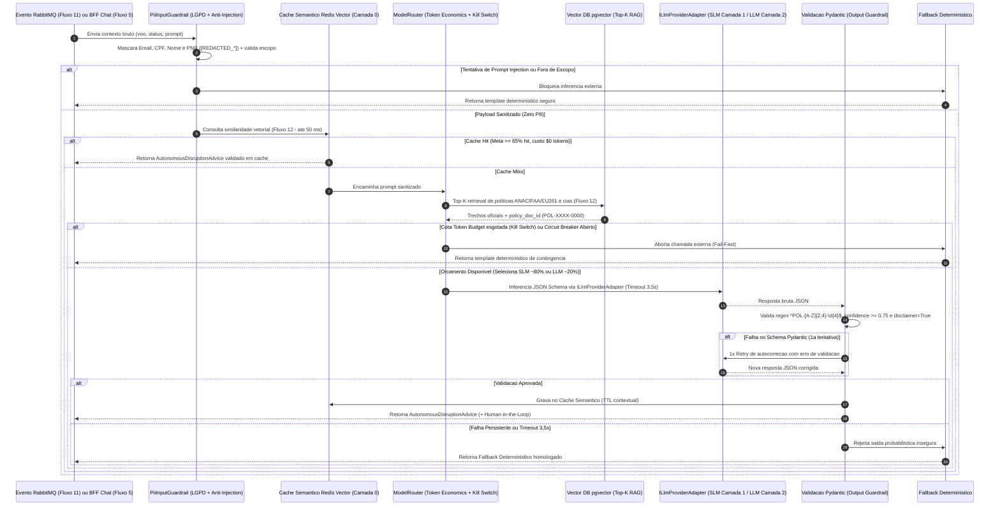

# Guardrails de Segurança, Roteamento Inteligente (Token Economics) e Pipeline RAG

> **Projeto:** The Road Warrior (Dashboard Global de Viagens em Tempo Real + AI Travel Copilot)  
> **Disciplina:** Arquitetura de Software — UniSENAI | **Equipe 5:** Vibecoders  
> **Autor (Branch `lucas`):** Lucas Sabino da Silva (Executor na Sprint 4; Líder na Sprint 3)

---

## 1. Arquitetura Defensiva para Componentes Probabilísticos

Modelos fundacionais de linguagem (SLMs e LLMs) apresentam natureza estocástica: estão sujeitos a alucinações factuais, variação de latência, ataques de injeção de instrução (*Prompt Injection*), exposição inadvertida de dados pessoais (`PII`) e escalada abrupta de custos financeiros.

Dentro do contêiner **`AI Engine & Guardrails Orchestrator`**, toda requisição — seja originada assincronamente por um `ReservationChangedEvent` vindo do RabbitMQ (**Fluxo 11**) ou sincronicamente pelo *Copilot Chat* via BFF (**Fluxo 5**) — atravessa obrigatoriamente um pipeline defensivo composto por seis estágios sequenciais antes de retornar qualquer recomendação ao viajante.

---

## 2. Estratégia do `ModelRouter` (Token Economics em 3 Camadas)

| Camada | Componente / Modelo Alvo | Volume / Meta | Latência e Custo Estimado | Escopo Tático de Atuação |
| :--- | :--- | :---: | :--- | :--- |
| **Camada 0** | **Cache Semântico** (`Redis Vector Similarity`) | Meta de *cache hit* `>= 65%` | `< 50 ms` \| Custo `$0` de tokens | Absorve perguntas e disrupções equivalentes (ex.: centenas de passageiros do mesmo voo cancelado consultando regras de assistência material). |
| **Camada 1** | **Fast / Economy Tier** (`SLM`: `Gemini Flash` / `Llama 3 8B`) | `~80%` das inferências | Baixa latência \| `$0,10` a `$0,30` / `1M` tokens | Triagem rápida, classificação de severidade, tradução de avisos de aeroporto, trocas simples de portão e resumos objetivos. |
| **Camada 2** | **Reasoning Tier** (`LLM`: `Gemini Pro` / `Claude Sonnet`) | `~20%` das inferências | Timeout `3,5s` \| Custo controlado por `Token Budget` | Reacomodação multi-trecho complexa cruzando regras tarifárias do RAG (`ANAC/FAA/EU261`), conexões perdidas e *late check-in* em hotéis, protegida por `max_tokens` rígido e *Kill Switch* financeiro. |

---

## 3. Pipeline de Guardrails e RAG com `pgvector`

1. **Guardrail de Entrada (`PiiInputGuardrail`):**
   - **Anonimização `LGPD/GDPR`:** remove e mascara dados pessoais antes que qualquer byte saia para APIs externas (**Fluxo 13**), substituindo e-mails por `[REDACTED_EMAIL]`, CPFs por `[REDACTED_CPF]`, nomes identificados por `[REDACTED_NAME]` e códigos localizadores alfanuméricos de 6 caracteres por `[REDACTED_PNR]`.
   - **Defesa contra *Prompt Injection* e *Topic Restriction*:** bloqueia tentativas de *jailbreak* (ex.: `"ignore todas as instruções anteriores"`) e rejeita solicitações fora do domínio de viagens corporativas e aviação.
2. **Recuperação Aumentada (`RAG` no `PostgreSQL + pgvector` — Fluxo 12):**
   - Em caso de *cache miss* na Camada 0, o motor executa *Top-K retrieval* (`< 50 ms`) sobre documentos oficiais homologados com identificadores padronizados (`POL-ANAC-0400`, `POL-GOL-1024`, `POL-EU-0261`, `POL-VIP-0012`), injetando apenas trechos auditáveis no contexto da inferência.
3. **Guardrail de Saída (Pydantic + Grounding + Human-in-the-Loop):**
   - Valida a saída estruturada nos contratos `RebookingActionOption` e `AutonomousDisruptionAdvice`:
     - `policy_doc_id` obrigatoriamente aderente à expressão regular `^POL-[A-Z]{2,4}-\d{4}$` (e pertencente ao conjunto recuperado no RAG, impedindo citação inventada);
     - `confidence_score >= 0.75`;
     - `disclaimer_required = True`;
     - `requires_human_approval = True` obrigatório para ações financeiras ou contratuais (`REBOOK_FLIGHT` e `HOTEL_LATE_CHECKIN`);
     - No máximo **`1` retry de autocorreção** (*self-correction retry*) caso a LLM retorne JSON fora do contrato.
4. **Fallback Determinístico:**
   - Acionado instantaneamente quando há tentativa de *Prompt Injection*, abertura do Circuit Breaker do provedor, estouro do `Token Budget` diário (*Kill Switch*) ou reprovação no schema Pydantic após `1` *retry*.

---

## 4. Diagrama de Sequência do Pipeline AI-Native



---

## 5. Implementação de Referência em Python

O código abaixo implementa integralmente os contratos e componentes do `AI Engine & Guardrails Orchestrator`: `PiiInputGuardrail`, `RebookingActionOption`, `AutonomousDisruptionAdvice`, `ILlmProviderAdapter` (DIP) e `ModelRouter` com `SemanticCache`, `RAG`, `Kill Switch` de orçamento, `1` *retry* de autocorreção e `Fallback` determinístico.

```python
from __future__ import annotations

import json
import re
from abc import ABC, abstractmethod
from dataclasses import dataclass, field
from enum import Enum
from typing import Literal

from pydantic import BaseModel, Field, ValidationError, field_validator, model_validator


# =====================================================================
# 1. GUARDRAIL DE ENTRADA: LGPD/GDPR (PII) + ANTI-INJECTION + ESCOPO
# =====================================================================

class SecurityPolicyViolationError(Exception):
    """Exceção disparada quando o input viola regras de Prompt Injection ou escopo."""


class PiiInputGuardrail:
    """Sanitiza dados sensíveis (LGPD/GDPR) antes de sair da rede interna (Fluxo 13)."""

    EMAIL_PATTERN = re.compile(r"[\w\.-]+@[\w\.-]+\.\w+")
    CPF_PATTERN = re.compile(r"\b\d{3}\.?\d{3}\.?\d{3}-?\d{2}\b")
    LABELED_NAME_PATTERN = re.compile(
        r"(?P<prefix>\b(?:passageir[oa]|viajante|cliente|titular|nome)\s*[:=-]\s*)"
        r"(?P<name>[A-ZÀ-Ÿ][a-zà-ÿ]+(?:\s+(?:da|de|do|dos|das|e|[A-ZÀ-Ÿ][a-zà-ÿ]+))+)"
    )
    PNR_PATTERN = re.compile(r"\b[A-Z0-9]{6}\b")

    INJECTION_PATTERNS = (
        re.compile(r"ignore\s+(?:todas\s+as\s+|all\s+)?(?:instru[cç][oõ]es|previous\s+instructions)", re.IGNORECASE),
        re.compile(r"system\s*prompt|jailbreak|modo\s+desenvolvedor", re.IGNORECASE),
    )

    ALLOWED_TRAVEL_KEYWORDS = (
        "voo", "portao", "portão", "atraso", "cancelado", "cancelamento", "bagagem",
        "reembolso", "reacomodacao", "reacomodação", "hotel", "check-in", "conexao",
        "conexão", "sala vip", "lounge", "embarque", "anac", "reserva", "assento",
    )

    @classmethod
    def sanitize_prompt(
        cls,
        raw_text: str,
        traveler_name: str | None = None,
        enforce_topic_scope: bool = False,
    ) -> str:
        """Remove 100% de e-mails, CPFs, nomes identificados e PNRs de 6 caracteres."""
        for pattern in cls.INJECTION_PATTERNS:
            if pattern.search(raw_text):
                raise SecurityPolicyViolationError("Tentativa de Prompt Injection bloqueada pelo Guardrail.")

        if enforce_topic_scope:
            lowered = raw_text.lower()
            if not any(keyword in lowered for keyword in cls.ALLOWED_TRAVEL_KEYWORDS):
                raise SecurityPolicyViolationError("Consulta fora do escopo corporativo de viagens.")

        sanitized = cls.EMAIL_PATTERN.sub("[REDACTED_EMAIL]", raw_text)
        sanitized = cls.CPF_PATTERN.sub("[REDACTED_CPF]", sanitized)

        if traveler_name and traveler_name.strip():
            escaped_name = re.escape(traveler_name.strip())
            sanitized = re.sub(escaped_name, "[REDACTED_NAME]", sanitized, flags=re.IGNORECASE)

        sanitized = cls.LABELED_NAME_PATTERN.sub(r"\g<prefix>[REDACTED_NAME]", sanitized)
        sanitized = cls.PNR_PATTERN.sub("[REDACTED_PNR]", sanitized)
        return sanitized


# =====================================================================
# 2. GUARDRAIL DE SAÍDA: CONTRATO ESTRITO EM PYDANTIC + HUMAN-IN-LOOP
# =====================================================================

FINANCIAL_OR_CONTRACTUAL_ACTIONS = {"REBOOK_FLIGHT", "HOTEL_LATE_CHECKIN"}


class RebookingActionOption(BaseModel):
    """Opção individual validada por JSON Schema e ancorada em documento RAG."""

    action_type: Literal["REBOOK_FLIGHT", "HOTEL_LATE_CHECKIN", "LOUNGE_ACCESS", "CONTACT_AIRLINE"]
    summary: str = Field(..., min_length=10, max_length=180, description="Resumo objetivo para o cartão do PWA")
    policy_doc_id: str = Field(
        ...,
        pattern=r"^POL-[A-Z]{2,4}-\d{4}$",
        description="Identificador auditável da política oficial no pgvector",
    )
    confidence_score: float = Field(..., ge=0.75, le=1.0, description="Confiança mínima exigida >= 0.75")
    requires_human_approval: bool = Field(
        default=True,
        description="Human-in-the-Loop obrigatório para ações financeiras ou contratuais",
    )

    @model_validator(mode="after")
    def enforce_human_in_the_loop(self) -> "RebookingActionOption":
        if self.action_type in FINANCIAL_OR_CONTRACTUAL_ACTIONS and not self.requires_human_approval:
            raise ValueError(
                f"A ação '{self.action_type}' envolve impacto financeiro/contratual e exige Human-in-the-Loop."
            )
        return self


class AutonomousDisruptionAdvice(BaseModel):
    """Payload final validado antes de publicar ProactiveAdviceReadyEvent (Fluxo 14)."""

    trip_id: str = Field(..., min_length=3)
    severity: Literal["LOW", "MEDIUM", "CRITICAL"]
    options: list[RebookingActionOption] = Field(..., min_length=1, max_length=3)
    disclaimer_required: bool = Field(default=True)
    source_tier: Literal["SEMANTIC_CACHE", "FAST_SLM", "REASONING_LLM", "DETERMINISTIC_FALLBACK"] = "FAST_SLM"

    @field_validator("disclaimer_required")
    @classmethod
    def must_require_legal_disclaimer(cls, value: bool) -> bool:
        if value is not True:
            raise ValueError("disclaimer_required deve ser obrigatoriamente True por governança jurídica.")
        return value


# =====================================================================
# 3. INVERSÃO DE DEPENDÊNCIA (DIP): PORTA ABSTRATA DO PROVEDOR DE IA
# =====================================================================

class ModelTier(str, Enum):
    FAST_SLM = "FAST_SLM"           # Camada 1 (~80% tráfego: Gemini Flash / Llama 3 8B)
    REASONING_LLM = "REASONING_LLM"  # Camada 2 (~20% tráfego: Gemini Pro / Claude Sonnet)


class ILlmProviderAdapter(ABC):
    """Porta abstrata (A = 1.0, I = 0.0, D = 0.0) evitando vendor lock-in."""

    @abstractmethod
    def generate_structured_json(
        self,
        sanitized_prompt: str,
        rag_context: list[dict[str, str]],
        tier: ModelTier,
        max_tokens: int,
        timeout_seconds: float = 3.5,
    ) -> str:
        """Executa inferência sanitizada exigindo retorno em JSON estrito."""


# =====================================================================
# 4. SUPORTE RAG (PGVECTOR), CACHE SEMÂNTICO E TOKEN BUDGET / ROUTER
# =====================================================================

@dataclass
class TokenBudgetState:
    """Guardião de Token Economics com Kill Switch financeiro para a Camada 2."""

    daily_limit_usd: float = 50.0
    spent_today_usd: float = 0.0
    circuit_breaker_open: bool = False

    def can_use_reasoning_tier(self) -> bool:
        return (not self.circuit_breaker_open) and (self.spent_today_usd < self.daily_limit_usd)

    def register_usage(self, tier: ModelTier, estimated_tokens: int) -> None:
        rate_per_million = 0.20 if tier == ModelTier.FAST_SLM else 3.00
        self.spent_today_usd += (estimated_tokens / 1_000_000) * rate_per_million


@dataclass
class SemanticCacheStore:
    """Simula o Cache Semântico no Redis Vector (Camada 0: < 50 ms, custo $0)."""

    _entries: dict[str, AutonomousDisruptionAdvice] = field(default_factory=dict)

    @staticmethod
    def _normalize_key(sanitized_prompt: str) -> str:
        return " ".join(sanitized_prompt.lower().split())

    def lookup(self, sanitized_prompt: str) -> AutonomousDisruptionAdvice | None:
        cached = self._entries.get(self._normalize_key(sanitized_prompt))
        if cached is not None:
            return cached.model_copy(update={"source_tier": "SEMANTIC_CACHE"})
        return None

    def store(self, sanitized_prompt: str, advice: AutonomousDisruptionAdvice) -> None:
        self._entries[self._normalize_key(sanitized_prompt)] = advice


class PgVectorRagRetriever:
    """Simula Top-K retrieval (< 50 ms) de normas ANAC/FAA/EU261 e políticas de cias."""

    POLICY_CORPUS: tuple[dict[str, str], ...] = (
        {
            "policy_doc_id": "POL-ANAC-0400",
            "content": "Resolução ANAC 400: atraso superior a 4h ou cancelamento garante reacomodação gratuita ou reembolso integral.",
        },
        {
            "policy_doc_id": "POL-GOL-1024",
            "content": "Política Gol: conexões perdidas por atraso operacional permitem remarcação sem multa e voucher de alimentação.",
        },
        {
            "policy_doc_id": "POL-VIP-0012",
            "content": "Política Lounge Corporativo: espera acima de 2h habilita acesso à sala VIP mediante cartão corporativo elegível.",
        },
    )

    def retrieve_top_k(self, sanitized_prompt: str, k: int = 2) -> list[dict[str, str]]:
        return list(self.POLICY_CORPUS[:k])


class ModelRouter:
    """Orquestrador AI-Native: Guardrails + Cache Semântico + Roteamento SLM/LLM + Fallback."""

    MAX_SELF_CORRECTION_RETRIES = 1

    def __init__(
        self,
        llm_adapter: ILlmProviderAdapter,
        semantic_cache: SemanticCacheStore | None = None,
        rag_retriever: PgVectorRagRetriever | None = None,
        budget_state: TokenBudgetState | None = None,
    ) -> None:
        self._llm_adapter = llm_adapter
        self._cache = semantic_cache or SemanticCacheStore()
        self._rag = rag_retriever or PgVectorRagRetriever()
        self._budget = budget_state or TokenBudgetState()

    def select_tier(self, sanitized_prompt: str, is_multi_leg_disruption: bool) -> ModelTier:
        """Roteia ~80% para Fast Tier (SLM) e ~20% complexos para Reasoning Tier (LLM)."""
        complex_triggers = ("cancelado", "conexão perdida", "conexao perdida", "multi-trecho", "hotel")
        needs_reasoning = is_multi_leg_disruption or any(t in sanitized_prompt.lower() for t in complex_triggers)
        if needs_reasoning and self._budget.can_use_reasoning_tier():
            return ModelTier.REASONING_LLM
        return ModelTier.FAST_SLM

    @staticmethod
    def build_deterministic_fallback(trip_id: str, flight_code: str = "SEU VOO") -> AutonomousDisruptionAdvice:
        """Fallback determinístico acionado em falhas de rede, cota ou validação de schema."""
        return AutonomousDisruptionAdvice(
            trip_id=trip_id,
            severity="MEDIUM",
            options=[
                RebookingActionOption(
                    action_type="CONTACT_AIRLINE",
                    summary=(
                        f"Alteração detectada em {flight_code}. Procure o balcão da companhia aérea "
                        "ou canais oficiais para assistência material e reacomodação."
                    )[:180],
                    policy_doc_id="POL-ANAC-0400",
                    confidence_score=1.0,
                    requires_human_approval=True,
                )
            ],
            disclaimer_required=True,
            source_tier="DETERMINISTIC_FALLBACK",
        )

    def handle_disruption(
        self,
        trip_id: str,
        raw_prompt: str,
        flight_code: str = "G3-1422",
        traveler_name: str | None = None,
        is_multi_leg_disruption: bool = False,
        enforce_topic_scope: bool = False,
    ) -> AutonomousDisruptionAdvice:
        """Executa o fluxo completo com garantia de Zero-PII, RAG, 1 retry e Fallback."""
        # 1. Guardrail de Entrada (PII + Anti-Injection + Escopo)
        try:
            sanitized_prompt = PiiInputGuardrail.sanitize_prompt(
                raw_prompt,
                traveler_name=traveler_name,
                enforce_topic_scope=enforce_topic_scope,
            )
        except SecurityPolicyViolationError:
            return self.build_deterministic_fallback(trip_id=trip_id, flight_code=flight_code)

        # 2. Camada 0: Cache Semântico (< 50 ms, $0 tokens)
        cached_advice = self._cache.lookup(sanitized_prompt)
        if cached_advice is not None:
            return cached_advice

        # 3. Verificação de Circuit Breaker do Provedor
        if self._budget.circuit_breaker_open:
            return self.build_deterministic_fallback(trip_id=trip_id, flight_code=flight_code)

        # 4. Recuperação RAG (pgvector) e Seleção de Camada (SLM vs LLM)
        rag_docs = self._rag.retrieve_top_k(sanitized_prompt, k=3)
        allowed_doc_ids = {doc["policy_doc_id"] for doc in rag_docs}
        selected_tier = self.select_tier(sanitized_prompt, is_multi_leg_disruption=is_multi_leg_disruption)
        max_tokens = 350 if selected_tier == ModelTier.FAST_SLM else 700

        # 5. Inferência via ILlmProviderAdapter + Validação Pydantic (máx. 1 retry)
        prompt_for_attempt = sanitized_prompt
        for _attempt in range(self.MAX_SELF_CORRECTION_RETRIES + 1):
            try:
                raw_json = self._llm_adapter.generate_structured_json(
                    sanitized_prompt=prompt_for_attempt,
                    rag_context=rag_docs,
                    tier=selected_tier,
                    max_tokens=max_tokens,
                    timeout_seconds=3.5,
                )
                self._budget.register_usage(selected_tier, estimated_tokens=max_tokens)

                parsed_payload = json.loads(raw_json)
                parsed_payload["trip_id"] = trip_id
                parsed_payload["source_tier"] = selected_tier.value
                validated_advice = AutonomousDisruptionAdvice.model_validate(parsed_payload)

                # Verifica ancoragem real (Grounding Check contra documentos retornados pelo RAG)
                for option in validated_advice.options:
                    if option.policy_doc_id not in allowed_doc_ids:
                        raise ValueError(f"Documento citado '{option.policy_doc_id}' ausente no contexto RAG.")

                self._cache.store(sanitized_prompt, validated_advice)
                return validated_advice

            except (TimeoutError, ConnectionError, RuntimeError):
                # Erro de provedor / rede cai direto para o Fallback determinístico
                return self.build_deterministic_fallback(trip_id=trip_id, flight_code=flight_code)
            except (json.JSONDecodeError, ValidationError, ValueError) as validation_err:
                prompt_for_attempt = (
                    f"{sanitized_prompt}\n[CORRECAO_SCHEMA]: corrija o JSON estritamente conforme erro: {validation_err}"
                )

        # 6. Fallback Determinístico após esgotar 1 retry de autocorreção
        return self.build_deterministic_fallback(trip_id=trip_id, flight_code=flight_code)
```
