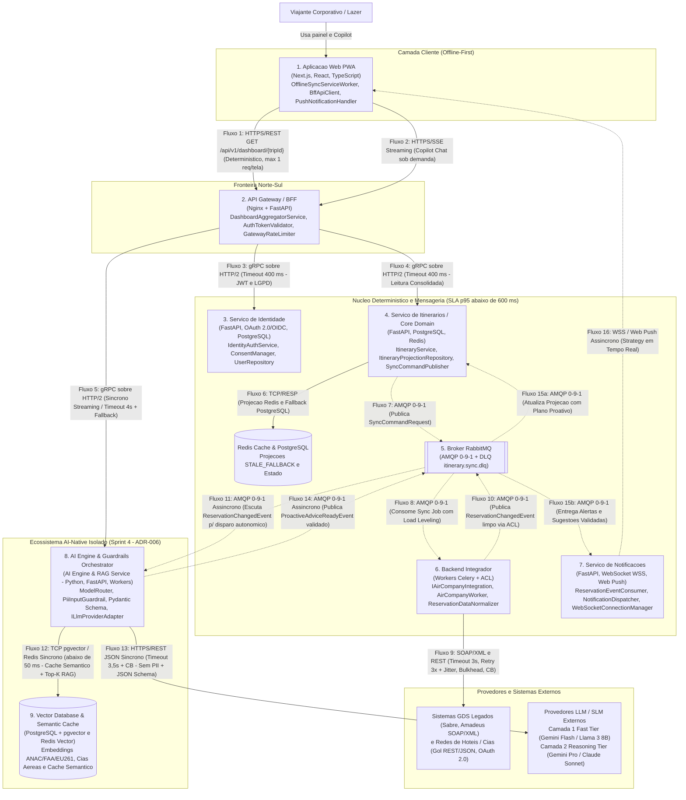

# Modelagem C4 (Nível 2 — Contêineres): Topologia AI-Native do The Road Warrior

> **Projeto:** The Road Warrior (Dashboard Global de Viagens em Tempo Real + AI Travel Copilot)  
> **Disciplina:** Arquitetura de Software — UniSENAI | **Equipe 5:** Vibecoders  
> **Autor (Branch `lucas`):** Lucas Sabino da Silva (Executor na Sprint 4; Líder nas Sprints 3)  
> **Demais Integrantes:** Gabriel Antunes da Silva, Wayron Jhonny de Souza, Eric da Silva Ferraz e Francisco Maganhatto

---

## 1. Visão Geral e a Regra de Ouro de Isolamento Determinístico

Na Sprint 4, o **The Road Warrior** evolui de um painel consolidado reativo para uma plataforma **AI-Native** dotada do **Assistente Autonômico de Reacomodação e AI Travel Copilot**, preservando integralmente as metas inegociáveis do *Quality Attribute Workshop* (QAW):

- **Performance:** `p95 < 600 ms` na abertura do dashboard (`GET /api/v1/dashboard/{tripId}`).
- **Usabilidade:** `<= 1` requisição HTTP por tela no PWA via agregação no BFF.
- **Escalabilidade:** `500.000` usuários simultâneos com *Load Leveling* no RabbitMQ.
- **Disponibilidade:** `>= 99,9%` com PWA *Offline-First* (`Service Worker` + `IndexedDB`) e contingência `STALE_FALLBACK` no Redis.

### Regra de Ouro Arquitetural
O carregamento principal do itinerário (`GET /api/v1/dashboard/{tripId}`) é **100% determinístico e fisicamente isolado dos componentes probabilísticos de IA**. Nenhuma inferência em SLM/LLM bloqueia a renderização do painel do passageiro:
1. Toda análise proativa de atraso severo ou cancelamento roda **assincronamente em segundo plano** via eventos no RabbitMQ (**Fluxos 11 e 14**).
2. Consultas conversacionais sob demanda no *Copilot Chat* utilizam um canal dedicado de *streaming* (**Fluxo 5**) com *timeout* agressivo (`4s`), proteção por Circuit Breaker e *Fallback* determinístico.

---

## 2. Inventário de Contêineres (C4 Nível 2)

### 2.1. Contêineres Determinísticos Consolidados (Sprints 1 a 3)
1. **Aplicação Web PWA** (`Next.js, React, TypeScript`): interface reativa *Offline-First* contendo `OfflineSyncServiceWorker`, `BffApiClient` e `PushNotificationHandler`.
2. **API Gateway / BFF** (`Nginx + FastAPI`): fronteira Norte-Sul com `DashboardAggregatorService` (Facade/Aggregator), `AuthTokenValidator` (JWT) e `GatewayRateLimiter` (`100 req/min`).
3. **Serviço de Identidade** (`FastAPI, OAuth 2.0/OIDC, PostgreSQL`): autenticação federada e privacidade com `IdentityAuthService`, `ConsentManager` (`LGPD/GDPR`) e `UserRepository`.
4. **Serviço de Itinerários / Core Domain** (`FastAPI, PostgreSQL, Redis`): núcleo de domínio com `ItineraryService`, `ItineraryProjectionRepository` e `SyncCommandPublisher`.
5. **Broker RabbitMQ** (`AMQP 0-9-1`): barramento assíncrono de comandos/eventos com *Load Leveling* e Dead Letter Queue (`itinerary.sync.dlq`).
6. **Backend Integrador** (`Workers Celery + ACL`): camada de integração contendo `IAirCompanyIntegration`, `SabreAirCompanyIntegration`, `AmadeusIntegration`, `GolIntegration`, `AirCompanyWorker` e `ReservationDataNormalizer` (Timeout `3s`, Retry `3x` com backoff exponencial `1s`/`2s`/`4s` + jitter `100–450 ms`, Bulkhead e Circuit Breaker `50%`/`20 reqs`/`30s`).
7. **Serviço de Notificações** (`FastAPI, WebSocket WSS, Web Push`): entrega multicanal em tempo real com `ReservationEventConsumer`, `NotificationDispatcher` (Strategy) e `WebSocketConnectionManager`.

### 2.2. Novos Contêineres AI-Native Incorporados na Sprint 4
8. **`AI Engine & Guardrails Orchestrator` (`AI Engine & RAG Service`)** (`Python, FastAPI, Workers`):
   - Contêiner dedicado que centraliza o `ModelRouter` (*Token Economics* em 3 camadas), aplica os Guardrails de entrada (`PiiInputGuardrail` para `LGPD/GDPR` e bloqueio de *Prompt Injection*) e de saída (contratos Pydantic `RebookingActionOption` e `AutonomousDisruptionAdvice`), executa consultas ao RAG e invoca provedores externos de SLM/LLM exclusivamente por meio da interface abstrata `ILlmProviderAdapter` (cumprindo o *Dependency Inversion Principle* sem *vendor lock-in*).
9. **`Vector Database & Semantic Cache`** (`PostgreSQL + pgvector` e `Redis Vector`):
   - Persistência especializada que mantém: (a) o **Cache Semântico** no `Redis Vector` para responder perguntas equivalentes em `< 50 ms` com meta de *cache hit* `>= 65%` e custo `$0` de tokens; e (b) a base vetorial **RAG** no `PostgreSQL + pgvector` com embeddings auditáveis de políticas tarifárias de companhias aéreas, franquias de bagagem, salas VIP e normas regulatórias (`ANAC`, `FAA`, `EU261`).

---

## 3. Diagrama C4 Nível 2 (Contêineres e Fluxos AI-Native)

---

## 4. Matriz de Conexões AI-Native (Obrigatória — Sprint 4)

A tabela a seguir formaliza rigorosamente as cinco conexões arquiteturais introduzidas pelo ecossistema AI-Native, garantindo rastreabilidade direta com o diagrama acima e com a `ADR-006`:

| Fluxo | Origem | Destino | Protocolo | Natureza e Resiliência | Papel Arquitetural no Ecossistema |
| :---: | :--- | :--- | :--- | :--- | :--- |
| **Fluxo 5** | `API Gateway / BFF` | `AI Engine & RAG Service` (`AI Engine & Guardrails Orchestrator`) | `gRPC sobre HTTP/2` | Síncrono (Streaming / Timeout `4s` + Fallback) | Atende interações sob demanda do **Copilot Chat** (exposto via `HTTPS/SSE` no PWA) para dúvidas de bagagem, conexão e salas VIP sem jamais tocar ou bloquear a rota determinística do dashboard. |
| **Fluxo 11** | `Broker RabbitMQ` | `AI Engine & RAG Service` (`AI Engine & Guardrails Orchestrator`) | `AMQP 0-9-1` | Assíncrono (Event Streaming) | Escuta eventos críticos `ReservationChangedEvent` (atraso severo ou cancelamento) para disparo autonômico de análise de reacomodação em segundo plano. |
| **Fluxo 12** | `AI Engine & RAG Service` | `Vector DB & Semantic Cache` (`PostgreSQL + pgvector` / `Redis Vector`) | `TCP (pgvector / Redis)` | Síncrono (`< 50 ms`) | Consulta o **Cache Semântico** primeiro (meta `>= 65%` hit a `$0`); em caso de *cache miss*, executa *Top-K retrieval* no RAG de normas `ANAC/FAA/EU261` e políticas das cias aéreas. |
| **Fluxo 13** | `AI Engine & RAG Service` (`ILlmProviderAdapter`) | `Provedores LLM / SLM` (`Gemini Flash/Pro`, `Llama 3 8B`, `Claude Sonnet`) | `HTTPS / REST (JSON)` | Síncrono (Timeout `3,5s` + Circuit Breaker) | Executa inferência já sanitizada pelo `PiiInputGuardrail` (zero PII — `LGPD/GDPR`), roteada por custo/complexidade e exigindo resposta em **JSON Schema** estrito. |
| **Fluxo 14** | `AI Engine & RAG Service` | `Broker RabbitMQ` | `AMQP 0-9-1` | Assíncrono (Desacoplado) | Publica o evento `ProactiveAdviceReadyEvent` contendo opções validadas pelo Pydantic (`policy_doc_id`, `confidence_score >= 0.75`) para gravação na projeção Redis e alerta via `NotificationDispatcher`. |

---

## 5. Síntese de Isolamento entre Caminho Crítico e Caminho Probabilístico

| Critério de Engenharia | Caminho Determinístico (`GET /api/v1/dashboard/{tripId}`) | Caminho Autonômico e Copilot (`Fluxos 5, 11, 12, 13 e 14`) |
| :--- | :--- | :--- |
| **Meta de Latência** | `p95 < 600 ms` (leitura imediata no Redis + gRPC `400 ms`) | `< 50 ms` em Cache Hit (Camada 0) ou até `3,5s–4,0s` em inferência externa |
| **Dependência de IA Externa** | **Zero (`0%`)** — continua `100%` operacional se provedores LLM caírem | Isolada por `ILlmProviderAdapter`, Timeout `3,5s`, Circuit Breaker e Kill Switch |
| **Comportamento sob Falha** | `STALE_FALLBACK` via Redis ou cache local `IndexedDB` no PWA | **Fallback Determinístico** com mensagem segura pré-aprovada e `Human-in-the-Loop` |
| **Requisições HTTP por Tela** | `<= 1` requisição consolidada pelo `DashboardAggregatorService` | Atualização reativa via `WebSocket (WSS)` / `Web Push` ou `SSE` dedicado |
