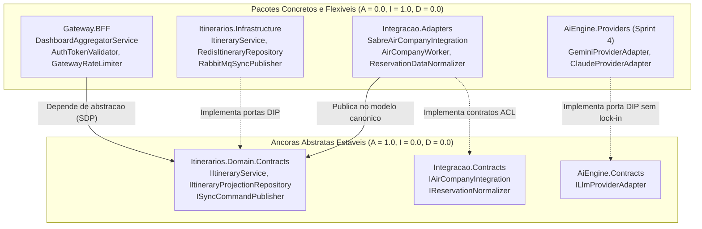
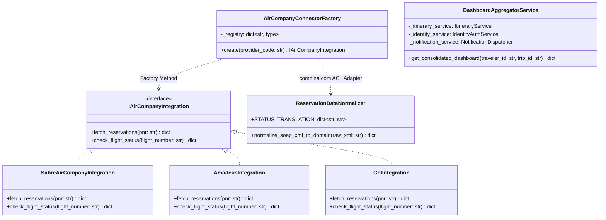
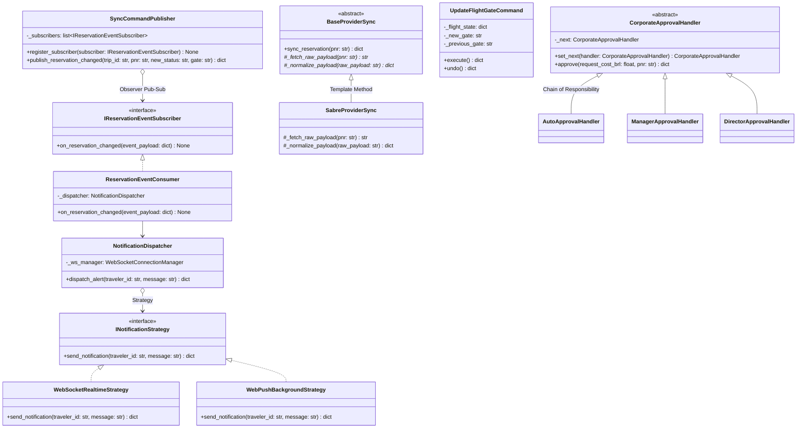

# Governança Quantitativa SOLID (`D = 0.0`) e Catálogo Tático de Padrões GoF

> **Projeto:** The Road Warrior (Dashboard Global de Viagens em Tempo Real + AI Travel Copilot)  
> **Disciplina:** Arquitetura de Software — UniSENAI | **Equipe 5:** Vibecoders  
> **Autor (Branch `lucas`):** Lucas Sabino da Silva (Executor na Sprint 4; Líder na Sprint 3)

---

## 1. Diagnóstico da "Zona de Dor" (`D = 1.0`) e Governança Quantitativa SOLID

A longevidade arquitetural do **The Road Warrior** apoia-se nos princípios **SOLID** — com ênfase no **DIP** (*Dependency Inversion Principle*) e no **OCP** (*Open/Closed Principle*) — auditados matematicamente pelas métricas de acoplamento e estabilidade de pacotes de **Robert C. Martin** (*Clean Architecture*):

- **Abstracionalidade (`A`):** `A = N_a / N_c`, razão entre o número de interfaces/classes abstratas (`N_a`) e o total de classes do pacote (`N_c`), variando no intervalo `[0.0, 1.0]`.
- **Acoplamento Aferente (`C_a`):** quantidade de classes externas que dependem do pacote analisado (responsabilidade para dentro).
- **Acoplamento Eferente (`C_e`):** quantidade de classes externas das quais o pacote analisado depende (dependência para fora).
- **Instabilidade (`I`):** `I = C_e / (C_a + C_e)`, onde `I = 0.0` representa estabilidade máxima (difícil de mudar) e `I = 1.0` representa instabilidade máxima (flexível e fácil de substituir).
- **Distância da Sequência Principal (`D`):** `D = |A + I - 1|`, onde `D = 0.0` indica equilíbrio arquitetural ideal.

### 1.1. O Problema no Modelo Monolítico Sem DIP (`Zona de Dor`)
Quando repositórios concretos do PostgreSQL/Redis, publicadores do RabbitMQ e clientes SOAP/REST eram instanciados diretamente dentro do pacote único de regras de negócio de Itinerários:
- O pacote acumulava dependentes externos (`C_a >= 2`) e não extraía contratos (`C_e = 0`), tornando-se rígido (`I = 0.0`).
- Simultaneamente, possuía apenas classes concretas (`N_a = 0 => A = 0.0`).
- Resultado matemático: `D = |0.0 + 0.0 - 1| = 1.0` (**Zona de Dor**). Qualquer mudança no schema XML da Sabre ou driver do Redis forçava recompilação e risco de regressão no Core Domain.

### 1.2. Refatoração para a Sequência Principal (`D = 0.0`) e SDP

Segregando portas abstratas (`.Contracts`) das implementações concretas (`.Infrastructure`, `.Adapters`, `.BFF`), posicionamos todos os pacotes exatamente sobre a Sequência Principal (`D = 0.0`), em estrita conformidade com o **Princípio das Dependências Estáveis (SDP)**:

| Módulo / Pacote do Sistema | Camada Arquitetural | `N_a` | `N_c` | `A = N_a / N_c` | `C_a` | `C_e` | `I = C_e / (C_a + C_e)` | Distância `D = \|A + I - 1\|` | Status Arquitetural |
| :--- | :--- | :---: | :---: | :---: | :---: | :---: | :---: | :---: | :--- |
| **`Itinerarios.Domain.Contracts`** | Domínio Central (Portas) | `3` | `3` | `1.0` | `>= 2` | `0` | `0.0` | `D = \|1.0 + 0.0 - 1\| = 0.0` | Sequência Principal (Âncora Estável) |
| **`Itinerarios.Infrastructure`** | Persistência e Mensageria | `0` | `3` | `0.0` | `0` | `3` | `1.0` | `D = \|0.0 + 1.0 - 1\| = 0.0` | Sequência Principal (Pluga Redis/PG/AMQP) |
| **`Integracao.Contracts`** | Contratos Padronizados ACL | `2` | `2` | `1.0` | `>= 2` | `0` | `0.0` | `D = \|1.0 + 0.0 - 1\| = 0.0` | Sequência Principal (Contrato Estável) |
| **`Integracao.Adapters`** | Conectores GDS e Workers | `0` | `3` | `0.0` | `0` | `2` | `1.0` | `D = \|0.0 + 1.0 - 1\| = 0.0` | Sequência Principal (Isola Terceiros) |
| **`Gateway.BFF`** | Orquestração para UI PWA | `0` | `3` | `0.0` | `0` | `3` | `1.0` | `D = \|0.0 + 1.0 - 1\| = 0.0` | Sequência Principal (Flexível p/ Tela) |
| **`AiEngine.Contracts`** *(Sprint 4)* | Porta IA (`ILlmProviderAdapter`) | `1` | `1` | `1.0` | `>= 2` | `0` | `0.0` | `D = \|1.0 + 0.0 - 1\| = 0.0` | Sequência Principal (Zero Vendor Lock-in) |



---

## 2. Diagramas de Classes UML (Mermaid) dos Padrões GoF do Projeto

### 2.1. Padrões Criacionais e Estruturais (`Factory Method`, `Adapter / ACL` e `Facade`)



### 2.2. Padrões Comportamentais (`Observer`, `Strategy`, `Template Method`, `Command` e `Chain of Responsibility`)



---

## 3. Implementações Táticas em Python dos 8 Padrões GoF

### 3.1. `Factory Method` (`AirCompanyConnectorFactory`)
Isola a decisão de instanciação polimórfica dos conectores de companhias aéreas e GDS (`ADR-001`), respeitando o OCP.

```python
from abc import ABC, abstractmethod


class IAirCompanyIntegration(ABC):
    """Porta estável em Integracao.Contracts (A = 1.0, I = 0.0, D = 0.0)."""

    @abstractmethod
    def fetch_reservations(self, pnr: str) -> dict:
        pass

    @abstractmethod
    def check_flight_status(self, flight_number: str) -> dict:
        pass


class SabreAirCompanyIntegration(IAirCompanyIntegration):
    def fetch_reservations(self, pnr: str) -> dict:
        return {"provider": "SABRE", "pnr": pnr, "format": "SOAP_XML"}

    def check_flight_status(self, flight_number: str) -> dict:
        return {"flight": flight_number, "status": "ON_TIME", "gate": "B12"}


class AmadeusIntegration(IAirCompanyIntegration):
    def fetch_reservations(self, pnr: str) -> dict:
        return {"provider": "AMADEUS", "pnr": pnr, "format": "SOAP_XML"}

    def check_flight_status(self, flight_number: str) -> dict:
        return {"flight": flight_number, "status": "DELAYED", "gate": "C04"}


class GolIntegration(IAirCompanyIntegration):
    def fetch_reservations(self, pnr: str) -> dict:
        return {"provider": "GOL", "pnr": pnr, "format": "REST_JSON"}

    def check_flight_status(self, flight_number: str) -> dict:
        return {"flight": flight_number, "status": "BOARDING", "gate": "A08"}


class AirCompanyConnectorFactory:
    """Factory Method: resolve o conector homologado pelo provider_code."""

    _registry: dict[str, type[IAirCompanyIntegration]] = {
        "SABRE": SabreAirCompanyIntegration,
        "AMADEUS": AmadeusIntegration,
        "GOL": GolIntegration,
    }

    @classmethod
    def create(cls, provider_code: str) -> IAirCompanyIntegration:
        connector_cls = cls._registry.get(provider_code.strip().upper())
        if not connector_cls:
            raise ValueError(f"Provedor aéreo não homologado: {provider_code}")
        return connector_cls()
```

### 3.2. `Adapter` / Camada Anti-Corrupção (`ReservationDataNormalizer`)
Traduz envelopes SOAP/XML legados (`LOCATOR`, `CARRIER`, `STAT_CD`) para a Linguagem Ubíqua do Core Domain (`ADR-001` e `ADR-004`).

```python
import xml.etree.ElementTree as ET


class ReservationDataNormalizer:
    """Adapter e Anti-Corruption Layer (ACL) no Backend Integrador."""

    STATUS_TRANSLATION: dict[str, str] = {
        "HK": "ON_TIME",
        "DL": "DELAYED",
        "XX": "CANCELLED",
    }

    def normalize_soap_xml_to_domain(self, raw_xml: str) -> dict:
        root = ET.fromstring(raw_xml)
        airline = root.findtext("CARRIER", default="UNK")
        flight_no = root.findtext("FLIGHT_NO", default="0000")
        legacy_status = root.findtext("STAT_CD", default="HK")
        return {
            "reservation_code": root.findtext("LOCATOR", default="UNKNOWN"),
            "airline_name": airline,
            "flight_number": f"{airline}-{flight_no}",
            "origin_iata": root.findtext("ORIG_APT", default="GRU"),
            "destination_iata": root.findtext("DEST_APT", default="CWB"),
            "gate": root.findtext("GATE_NO", default="TBD"),
            "status": self.STATUS_TRANSLATION.get(legacy_status, "ON_TIME"),
        }
```

### 3.3. `Facade` (`DashboardAggregatorService`)
Consolida múltiplos microsserviços internos em payload único no API Gateway / BFF, sustentando `<= 1` requisição HTTP por tela e `p95 < 600 ms` (`ADR-005`).

```python
class DashboardAggregatorService:
    """Padrão Facade no BFF: garante <= 1 requisição HTTP por tela no PWA."""

    def __init__(self, itinerary_service, identity_service, notification_service) -> None:
        self._itinerary_service = itinerary_service
        self._identity_service = identity_service
        self._notification_service = notification_service

    def get_consolidated_dashboard(self, traveler_id: str, trip_id: str) -> dict:
        profile = self._identity_service.get_verified_profile(traveler_id)
        projection = self._itinerary_service.get_consolidated_itinerary(traveler_id, trip_id)
        unread_count = self._notification_service.get_unread_count(traveler_id)
        return {
            "tripId": trip_id,
            "travelerName": profile["name"],
            "lgpdConsentActive": profile["consent_active"],
            "syncMetadata": {
                "state": projection["sync_status"],
                "lastSyncAt": projection["last_updated_iso"],
            },
            "flights": projection["flights"],
            "hotels": projection["hotels"],
            "unreadNotifications": unread_count,
        }
```

### 3.4. `Observer / Publish-Subscribe` (`SyncCommandPublisher` e `ReservationEventConsumer`)
Desacopla temporalmente a detecção de mudanças de voo e a reação dos consumidores — incluindo o Serviço de Notificações e o disparo autonômico do `AI Engine` via RabbitMQ (`ADR-002` e `ADR-006`).

```python
from abc import ABC, abstractmethod


class IReservationEventSubscriber(ABC):
    @abstractmethod
    def on_reservation_changed(self, event_payload: dict) -> None:
        pass


class SyncCommandPublisher:
    """Subject / Publisher assíncrono de eventos ReservationChangedEvent."""

    def __init__(self) -> None:
        self._subscribers: list[IReservationEventSubscriber] = []

    def register_subscriber(self, subscriber: IReservationEventSubscriber) -> None:
        self._subscribers.append(subscriber)

    def publish_reservation_changed(self, trip_id: str, pnr: str, new_status: str, gate: str) -> dict:
        event = {
            "event_type": "ReservationChangedEvent",
            "trip_id": trip_id,
            "pnr": pnr,
            "new_status": new_status,
            "gate": gate,
        }
        for subscriber in self._subscribers:
            subscriber.on_reservation_changed(event)
        return {"status": "PUBLISHED_TO_BROKER", "event": event}


class ReservationEventConsumer(IReservationEventSubscriber):
    """Observer concreto no Serviço de Notificações."""

    def __init__(self, dispatcher) -> None:
        self._dispatcher = dispatcher

    def on_reservation_changed(self, event_payload: dict) -> None:
        alert = (
            f"Reserva {event_payload['pnr']} alterada para "
            f"{event_payload['new_status']} (Portão {event_payload['gate']})."
        )
        self._dispatcher.dispatch_alert(event_payload["trip_id"], alert)
```

### 3.5. `Strategy` (`NotificationDispatcher`)
Seleciona em tempo de execução o canal ideal de notificação (`WebSocket WSS` para sessão ativa ou `Web Push` para segundo plano/offline) sem condicionais rígidas espalhadas.

```python
from abc import ABC, abstractmethod


class INotificationStrategy(ABC):
    @abstractmethod
    def send_notification(self, traveler_id: str, message: str) -> dict:
        pass


class WebSocketRealtimeStrategy(INotificationStrategy):
    def send_notification(self, traveler_id: str, message: str) -> dict:
        return {"channel": "WEBSOCKET_WSS", "recipient": traveler_id, "message": message}


class WebPushBackgroundStrategy(INotificationStrategy):
    def send_notification(self, traveler_id: str, message: str) -> dict:
        return {"channel": "WEB_PUSH_SW", "recipient": traveler_id, "message": message}


class WebSocketConnectionManager:
    def __init__(self, active_sessions: set[str]) -> None:
        self._active_sessions = active_sessions

    def is_user_online(self, traveler_id: str) -> bool:
        return traveler_id in self._active_sessions


class NotificationDispatcher:
    """Contexto Strategy orquestrando entrega multicanal."""

    def __init__(self, ws_manager: WebSocketConnectionManager) -> None:
        self._ws_manager = ws_manager
        self._ws_strategy = WebSocketRealtimeStrategy()
        self._push_strategy = WebPushBackgroundStrategy()

    def dispatch_alert(self, traveler_id: str, message: str) -> dict:
        strategy = (
            self._ws_strategy if self._ws_manager.is_user_online(traveler_id) else self._push_strategy
        )
        return strategy.send_notification(traveler_id, message)
```

### 3.6. `Template Method` (`BaseProviderSync`)
Define o esqueleto invariável da rotina de sincronização nos *workers* (validação de localizador PNR, aplicação de governança de timeout `3s`, coleta bruta e normalização ACL), delegando às subclasses apenas os passos específicos do protocolo de cada parceiro.

```python
from abc import ABC, abstractmethod


class BaseProviderSync(ABC):
    """Template Method padronizando o pipeline de sincronização dos Workers."""

    TIMEOUT_SECONDS: float = 3.0

    def sync_reservation(self, pnr: str) -> dict:
        normalized_pnr = pnr.strip().upper()
        if len(normalized_pnr) != 6 or not normalized_pnr.isalnum():
            raise ValueError(f"PNR inválido para sincronização: {pnr}")

        raw_payload = self._fetch_raw_payload(normalized_pnr)
        canonical_data = self._normalize_payload(raw_payload)
        canonical_data["timeout_enforced_s"] = self.TIMEOUT_SECONDS
        return canonical_data

    @abstractmethod
    def _fetch_raw_payload(self, pnr: str) -> str:
        """Passo variável: busca em SOAP/XML ou REST/JSON."""

    @abstractmethod
    def _normalize_payload(self, raw_payload: str) -> dict:
        """Passo variável: converte para o contrato canônico limpo."""


class SabreProviderSync(BaseProviderSync):
    def _fetch_raw_payload(self, pnr: str) -> str:
        return f"<Sabre><LOCATOR>{pnr}</LOCATOR><CARRIER>G3</CARRIER><FLIGHT_NO>1422</FLIGHT_NO><STAT_CD>DL</STAT_CD></Sabre>"

    def _normalize_payload(self, raw_payload: str) -> dict:
        return ReservationDataNormalizer().normalize_soap_xml_to_domain(raw_payload)
```

### 3.7. `Command` (`UpdateFlightGateCommand` com Rollback `undo`)
Encapsula mutações de estado operacional do trecho de voo como objetos auditáveis e idempotentes, permitindo reversão imediata (`undo`) caso uma transação distribuída subsequente falhe.

```python
class UpdateFlightGateCommand:
    """Padrão Command com suporte a execução determinística e rollback (undo)."""

    def __init__(self, flight_segment_state: dict, new_gate: str) -> None:
        self._flight_state = flight_segment_state
        self._new_gate = new_gate
        self._previous_gate: str | None = None
        self._executed: bool = False

    def execute(self) -> dict:
        self._previous_gate = self._flight_state.get("gate")
        self._flight_state["gate"] = self._new_gate
        self._executed = True
        return dict(self._flight_state)

    def undo(self) -> dict:
        if self._executed and self._previous_gate is not None:
            self._flight_state["gate"] = self._previous_gate
            self._executed = False
        return dict(self._flight_state)
```

### 3.8. `Chain of Responsibility` (Alçadas Corporativas: Automática -> Gestor -> Diretoria)
Materializa a governança **Human-in-the-Loop** exigida pela `ADR-006` para reacomodações corporativas pagas sugeridas pelo Assistente Autonômico, escalonando a aprovação conforme o impacto financeiro da diferença tarifária.

```python
from __future__ import annotations
from abc import ABC, abstractmethod


class CorporateApprovalHandler(ABC):
    """Handler base da cadeia de alçadas corporativas para remarcação."""

    def __init__(self) -> None:
        self._next: CorporateApprovalHandler | None = None

    def set_next(self, handler: CorporateApprovalHandler) -> CorporateApprovalHandler:
        self._next = handler
        return handler

    @abstractmethod
    def approve(self, fare_difference_brl: float, pnr: str) -> dict:
        if self._next is not None:
            return self._next.approve(fare_difference_brl, pnr)
        raise RuntimeError("Nenhum nível de alçada configurado para aprovar a despesa.")


class AutoApprovalHandler(CorporateApprovalHandler):
    """Nível 1: Aprovação Automática para reacomodação gratuita ANAC ou até R$ 500,00."""

    def approve(self, fare_difference_brl: float, pnr: str) -> dict:
        if fare_difference_brl <= 500.00:
            return {"pnr": pnr, "tier": "AUTOMATICA", "status": "APPROVED", "human_required": False}
        return super().approve(fare_difference_brl, pnr)


class ManagerApprovalHandler(CorporateApprovalHandler):
    """Nível 2: Alçada do Gestor imediato para diferenças entre R$ 500,01 e R$ 2.500,00."""

    def approve(self, fare_difference_brl: float, pnr: str) -> dict:
        if fare_difference_brl <= 2500.00:
            return {"pnr": pnr, "tier": "GESTOR", "status": "PENDING_MANAGER_APPROVAL", "human_required": True}
        return super().approve(fare_difference_brl, pnr)


class DirectorApprovalHandler(CorporateApprovalHandler):
    """Nível 3: Alçada da Diretoria para diferenças tarifárias acima de R$ 2.500,00."""

    def approve(self, fare_difference_brl: float, pnr: str) -> dict:
        return {"pnr": pnr, "tier": "DIRETORIA", "status": "PENDING_DIRECTOR_APPROVAL", "human_required": True}
```
